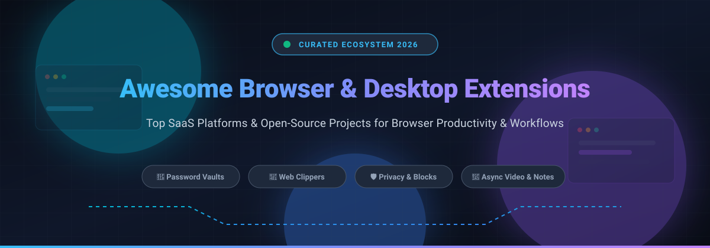

# 🚀 Awesome-Browser-Desktop-Extensions

  

  
  
  
  
  

---

## 🌟 Top Browser & Desktop Extensions Ecosystem

> **A Curated Directory of Category-Leading SaaS Products & High-Performance Open-Source GitHub Projects**  
> *Focused on Developer Productivity, Zero-Knowledge Password Vaults, Content Web Clippers, AI Writing Copilots, Ad-Blocking, Privacy, and Asynchronous Communication Tools.*  
> **Last updated: March 2026**

This repository tracks notable **SaaS platforms** and **open-source projects** for **Browser & Desktop Extensions**. These tools extend browser and desktop functionality—covering password management, grammar checking, screen recording, web clipping, CRM integration, and read-later workflows—helping users capture, organize, and act on information without leaving their workflow.

- ⚡ **Category Leaders**: Grammarly, Zoho CRM, Notion Web Clipper, HubSpot Sales, 1Password, ClickUp, LastPass, Loom, Evernote Web Clipper, and Pocket.
- 🔓 **Open-Source & Privacy First**: Highlighting battle-tested open-source alternatives for self-hosted password managers, grammar checkers, local-first web archiving tools, and async screen recording suites.

Contributions are warmly welcome! Feel free to open a Pull Request to suggest new extensions or update entries.

---

## 📑 Table of Contents
- [📊 Sector Overview & Market Dynamics](#-sector-overview--market-dynamics)
- [💼 SaaS / Hosted Platforms](#-saas--hosted-platforms)
- [🔓 Open-Source GitHub Projects](#-open-source-github-projects)
  - [⭐ Ranked Open-Source Extensions](#-ranked-open-source-extensions)
  - [🛠️ Additional Open-Source Options & Frameworks](#️-additional-open-source-options--frameworks)
- [📈 Star History](#-star-history)
- [🤝 How to Contribute](#-how-to-contribute)
- [💖 Support & Sponsorship](#-support--sponsorship)
- [⚠️ Disclaimer](#️-disclaimer)

---

## 📊 Sector Overview & Market Dynamics

The global browser extension market is estimated at approximately **$2.5 billion to $7.8 billion** (with the broader productivity software market exceeding **$80 billion to $100+ billion**), fueled by rapid growth in AI-driven browser copilots and enterprise security extensions. The ecosystem is moderately fragmented across specialized verticals (such as note-clipping, screen recording, and grammar tools), while converging toward winner-take-most dynamics in core foundational infrastructure like enterprise CRM sidecars and zero-knowledge password management suites where network effects and platform lock-in dominate.

---

## 💼 SaaS / Hosted Platforms

| 🏷️ Product | 🏢 Company Size (Valuation / Revenue) | 💳 Starting Paid Tier Pricing | 🎁 Free Tier Limits | 📝 Description |
| :--- | :--- | :--- | :--- | :--- |
| **[Grammarly Extension](https://www.grammarly.com/browser/chrome)** | ~$13B Valuation (~$700M ARR) | $12/user/month (billed annually as $144/yr) or $30/mo | **Free Forever**: Capped at 100 AI prompts/mo; includes basic grammar, spelling, and tone detection (excludes full-sentence rewrites, plagiarism checker, and advanced clarity adjustments). | AI writing assistant working across apps and sites; provides grammar correction, tone detection, and generative drafts. |
| **[Zoho Plug-in (CRM for Gmail)](https://chromewebstore.google.com/detail/zoho-crm-for-gmail/ojhlgnehlajjgpneocngnphjellkjgch)** | ~$12B Valuation (~$1.5B Revenue) | $14/user/month (billed annually) or $20/user/month | **Free Forever**: Up to 3 users, 5,000 records total, 1 GB organization file storage; limited to 1 sales pipeline and basic modules (no mass email or custom workflow automation). 15-day free trial on paid plans. | Gmail extension for managing Zoho CRM leads and contacts directly from inbox; log calls, add tasks, and create deals. |
| **[Notion Web Clipper](https://www.notion.com/help/web-clipper)** | ~$11B Valuation (~$600M ARR) | $10/seat/month (billed annually) or $12/seat/month (Plus Plan) | **Free Forever**: Unlimited blocks for solo users, 1,000 block lifetime limit if 2+ members collaborate, 5 MB file upload limit, 7-day page version history, and up to 10 guest invites. | Saves any web page or article directly into Notion databases with tags, metadata, and custom properties. |
| **[HubSpot Sales Extension](https://chromewebstore.google.com/detail/hubspot-sales/oiiaigjnkhngdbnoookogelabohpglmd)** | ~$10.5B Market Cap (~$3.1B+ Revenue) | $20/seat/month (Sales Hub Starter) | **Free Forever**: Up to 2 free users/seats, 1 deal pipeline, 10 custom properties, 3 email templates/snippets per user, 1 personal meeting link, and 5 uploaded documents; includes HubSpot branding. | Gmail/Outlook CRM sidebar with email tracking, templates, meeting scheduling, and Breeze AI Copilot connecting to HubSpot Smart CRM. |
| **[1Password Extension](https://1password.com/downloads/browser-extension)** | ~$6.8B Valuation (~$500M ARR) | $2.99/month (billed annually at $35.88/yr for Individual) | **14-Day Free Trial Only**: 14-day trial with full feature access and 1 GB encrypted document storage; requires paid subscription thereafter (no permanent free tier). | Password manager extension with autofill, passkey support, two-factor authentication autofill, and cross-browser vault syncing. |
| **[ClickUp Extension](https://clickup.com/chrome-extension)** | ~$4.0B Valuation (~$300M ARR) | $7/user/month (billed annually) or $10/user/month (Unlimited Plan) | **Free Forever**: Unlimited tasks and members, but storage is strictly capped at 100 MB total workspace storage; limited to 100 automation runs/month and 5 Spaces. | Creates tasks from websites and emails, captures annotated screenshots, and tracks time natively inside the browser. |
| **[LastPass Extension](https://support.lastpass.com/)** | ~$4.3B Transaction Value (~$110M+ Revenue) | $3.00/month (billed annually at $36/yr for Premium) | **Free Forever**: Restricted to a single device category only (either mobile devices or computer/desktop browsers, but not both); includes a 30-day Premium trial upon signup. | Browser extension for password vaulting, form autofill, password generation, and security auditing across browsers. |
| **[Loom Extension](https://chromewebstore.google.com/detail/loom-%E2%80%93-screen-recorder-sc/liecbddmkiiihnedobmlmillhodjkdmb)** | ~$975M Acquisition Value (~$100M ARR) | $18/creator/month (Business Plan billed monthly) or $15/creator/month (billed annually) | **Free Forever (Starter)**: Capped at 25 total stored videos per creator and a strict maximum recording length of 5 minutes per video; 720p maximum resolution with Loom watermarking. | Screen and webcam recording extension offering instant shareable links, viewer engagement analytics, and auto-transcriptions. |
| **[Pocket Extension](https://getpocket.com/)** | ~$680M Parent Mozilla Revenue (Acquired for undisclosed sum) | Discontinued (historically $4.99/month or $44.99/year) | **Discontinued**: Historically had a free plan with unlimited article saves and tagging; Mozilla officially sunset and shut down Pocket services on July 8, 2025. | Read-later extension for saving articles, videos, and web pages to a personal offline library (sunset by Mozilla). |
| **[Evernote Web Clipper](https://chromewebstore.google.com/detail/evernote-web-clipper/pioclpoplcdbaefihamjohnefbikjilc)** | ~$340M Acquisition Value (~$100M+ Revenue) | $14.99/month or $99/year (Starter Plan) | **Free Forever**: Strictly limited to 50 notes, 1 notebook, 1 active device connection, and 25 MB max monthly upload quota; 7-day or 14-day trials occasionally offered for paid tiers. | Saves full web pages, simplified articles, PDFs, and screenshots with custom highlighting directly to Evernote notebooks. |

---

## 🔓 Open-Source GitHub Projects

### ⭐ Ranked Open-Source Extensions
*Sorted in descending order by GitHub stargazers count.*

1. **[uBlock Origin](https://github.com/gorhill/uBlock)**   
   🛡️ Highly efficient, wide-spectrum content blocker and privacy guard for Chromium and Firefox with minimal memory and CPU footprint.

2. **[Trilium Notes Web Clipper](https://github.com/TriliumNext/Trilium)**   
   🌲 Hierarchical personal knowledge base and note-taking application with a built-in browser clipper for capturing whole pages, text clips, and screenshots.

3. **[Cap](https://github.com/CapSoftware/Cap)**   
   🎥 Modern open-source Loom alternative built with Rust and Tauri; offers instant screen recording, browser recording, and shareable links.

4. **[SingleFile](https://github.com/gildas-lormeau/SingleFile)**   
   💾 Web extension for saving a faithful, complete web page into a standalone, offline HTML file with embedded styling, images, and annotations.

5. **[Dark Reader](https://github.com/darkreader/darkreader)**   
   🌙 Browser extension providing eye-care dark theme inversion for any website on the fly, with customizable brightness, contrast, and font styling.

6. **[LanguageTool](https://github.com/languagetool-org/languagetool)**   
   ✍️ Open-source multilingual style and grammar checker supporting 25+ languages; trusted privacy-focused alternative to Grammarly for Chrome and Firefox.

7. **[Notesnook Web Clipper](https://github.com/streetwriters/notesnook)**   
   🔐 Zero-knowledge, fully encrypted private note-taking app with a dedicated web clipper extension utilizing XChaCha20-Poly1305 encryption.

8. **[Bitwarden Browser Extension](https://github.com/bitwarden/clients)**   
   🔑 Industry-standard open-source password vault extension featuring secure auto-fill, two-factor authentication, cross-device sync, and passkey support.

9. **[wallabag](https://github.com/wallabag/wallabag)**   
   📖 Self-hostable application and browser extension for saving web articles to read later, featuring offline viewing, e-reader export (EPUB/MOBI), and full content extraction.

10. **[Violentmonkey](https://github.com/violentmonkey/violentmonkey)**   
    🐵 Lightweight, open-source userscript manager for browsers supporting Greasemonkey and Tampermonkey scripts with synchronisation capabilities.

11. **[KeePassXC-Browser](https://github.com/keepassxreboot/keepassxc-browser)**   
    🔒 Official browser integration extension for the KeePassXC password manager, providing local-first credential and TOTP autofill without cloud exposure.

12. **[Hoppscotch Browser Extension](https://github.com/hoppscotch/hoppscotch-extension)**   
    🚀 Open-source API development and testing browser companion to bypass CORS restrictions for seamless API exploration and testing.

13. **[SendRec](https://github.com/sendrec/sendrec)**   
    📹 Self-hosted asynchronous video messaging platform; open-source Loom alternative with browser recording, AI transcription (local Whisper or cloud), and analytics.

14. **[SleekAddons Browser Extensions](https://github.com/SleekAddons/browser-extensions)**   
    🧩 Modern monorepo of productivity extensions including Table Extractor, Pi-hole Manager, and Website Blocker built with WXT and React.

15. **[Zecrypt Server](https://github.com/zecrypt-io/zecrypt-server)**   
    🛡️ Open-source password manager and encrypted data platform positioned as a LastPass alternative, built with FastAPI and Next.js.

---

### 🛠️ Additional Open-Source Options & Frameworks

- **[StashRead](https://addons.mozilla.org/firefox/addon/stashread/)** — Privacy-first read-later extension as a local alternative to Pocket; saves articles, extracts full content, and exports to EPUB for Kindle.
- **[Stashed](https://chromewebstore.google.com/detail/stashed/kkobgegdpdfgghkodioiadheabllcflg)** — Open-source Pocket alternative for saving and organizing web pages with custom tags and folders.
- **Building Your Custom Extension Stack**: Combine **LanguageTool** for grammar assistance, **SingleFile** or **Notesnook Clipper** for web archiving, **Cap** or **SendRec** for async screen video capture, **wallabag** for read-later workflows, and **Bitwarden** or **KeePassXC** for credentials—all deployable locally or self-hosted via Docker.

---

## 📈 Star History

---

## 🤝 How to Contribute

Contributions make the open-source community thrive! You can contribute by following these simple steps:

1. 🍴 **Fork the repository**
2. 🌿 **Create a feature branch** (`git checkout -b feature/new-extension`)
3. 📝 **Add/edit entries in `README.md`** (follow existing table or list format with factual links)
4. 💾 **Commit your changes** (`git commit -m 'feat: add new browser extension'`)
5. 🚀 **Push to the branch** (`git push origin feature/new-extension`)
6. 📬 **Open a Pull Request** with a concise description of the extension

---

## 💖 Support & Sponsorship

If you find this curated directory helpful for your daily workflow, personal privacy stack, or developer setup, please consider showing your support:

- ⭐ **Star this repository** to help others discover it!
- 🍴 **Fork and share** with colleagues and friends.
- ☕ **Buy me a coffee**: Sponsor this and other open-source projects via the [GitHub Sponsor Dashboard](https://github.com/sponsors/ishandutta2007).

Thank you for your generosity and continuous encouragement! 🙌

---

## ⚠️ Disclaimer

- This repository is a **community-curated list** created for informational and educational purposes — not an endorsement.
- Browser extensions request varying levels of permissions and data access; always inspect permission scopes, source code, and privacy policies before installation, particularly for tools handling passwords, sensitive email, or browsing history.
- Self-hosted open-source extensions and backend services require proper security hardening, regular updates, and backup strategies to protect user data.

---

  <b>Made with ❤️ for privacy-conscious users, productivity enthusiasts, and developers worldwide.</b> 
  Let's make browser and desktop extensions more open, transparent, and user-controlled.

